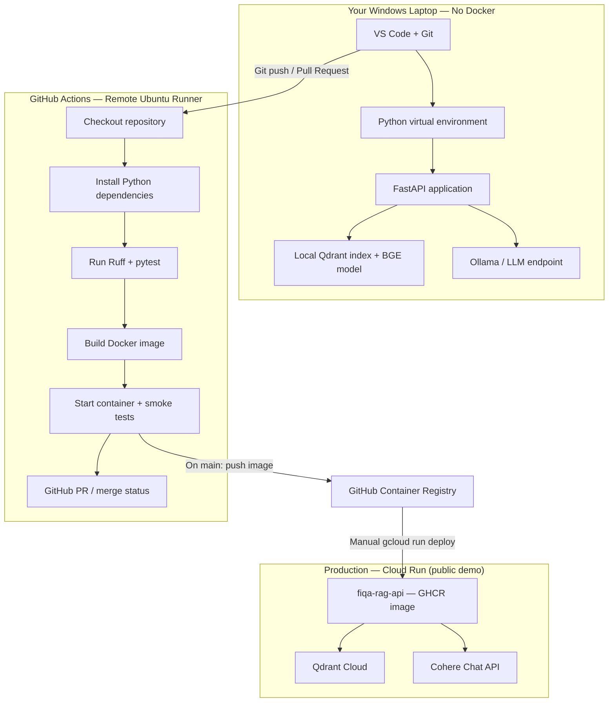

# Engineering topology (Week 8–9)

How **local development**, **GitHub Actions**, **GHCR**, and **Cloud Run production** fit together. The RAG pipeline diagram (ingest → Qdrant → LLM) lives in [README §2](../README.md#2-system-architecture) and [`PROJECT_SPEC.md`](../PROJECT_SPEC.md).

**Hosted API:** Public **Google Cloud Run** service **`fiqa-rag-api`** (project **`fiqa-production-rag`**, region **`asia-south1`**) — https://fiqa-rag-api-729436472430.asia-south1.run.app — uses **Qdrant Cloud** + **Cohere** + baked BGE. Operations and **manual release after `main`:** [`public_demo_operations_runbook.md`](public_demo_operations_runbook.md). First-deploy history: [`cloud_run_deployment.md`](cloud_run_deployment.md).

## Dev → CI → registry → cloud

**Release path:** merge to `main` → CI + Container workflows → GHCR (`latest` + commit SHA). **Cloud Run is updated only when you run** `gcloud run deploy` with the new image tag ([`public_demo_operations_runbook.md` §6–§7](public_demo_operations_runbook.md#6-what-happens-when-code-is-merged-into-main)).

## Workflows

| Workflow | File | On PR | On `main` |
|----------|------|-------|-----------|
| **CI** | [`.github/workflows/ci.yml`](../.github/workflows/ci.yml) | Ruff + pytest | Same |
| **Container** | [`.github/workflows/container.yml`](../.github/workflows/container.yml) | Build + `/health` smoke | Smoke + push to **GHCR** |

## GHCR image

`ghcr.io/ankush1aggarwal/fiqa-production-rag` — **production demo revision:** tag **`4f5ddf3`** (manual deploy per [`public_demo_operations_runbook.md`](public_demo_operations_runbook.md)).

## Related

- [`public_demo_operations_runbook.md`](public_demo_operations_runbook.md) — public demo URL, manual release, rollback  
- [`cloud_run_deployment.md`](cloud_run_deployment.md) — first-deploy IAM and validation history  
- [`cloud_run.md`](cloud_run.md) — Qdrant migration, env vars, app/runtime prep  
- [`week8_sprint.md`](week8_sprint.md) — container + CI checklist  
- [`observability_guide.md`](observability_guide.md) — JSON logs on stderr  
- [`api_contract.md`](api_contract.md) — HTTP API
