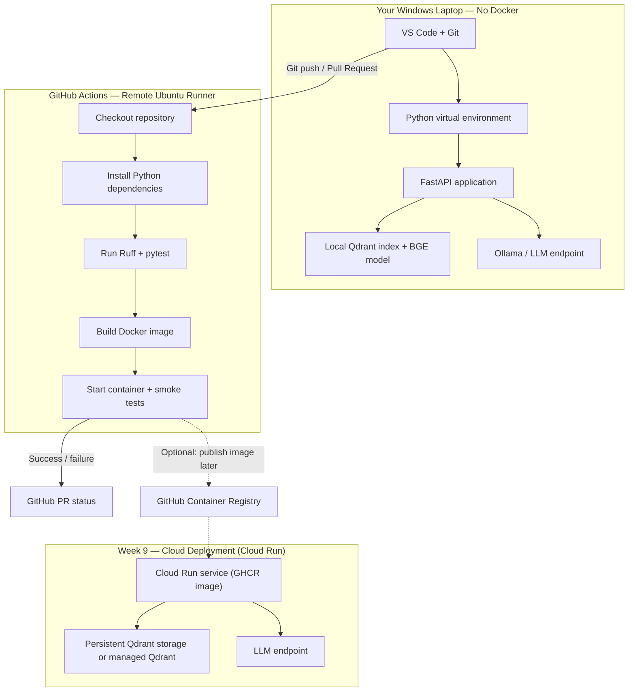

# Engineering topology (Week 8)

How **local development**, **GitHub Actions**, **GHCR**, and **Week 9 cloud** fit together. The RAG pipeline diagram (ingest → Qdrant → LLM) lives in [README §2](../README.md#2-system-architecture) and [`PROJECT_SPEC.md`](../PROJECT_SPEC.md).

## Dev → CI → registry → cloud

## Workflows

| Workflow | File | On PR | On `main` |
|----------|------|-------|-----------|
| **CI** | [`.github/workflows/ci.yml`](../.github/workflows/ci.yml) | Ruff + pytest | Same |
| **Container** | [`.github/workflows/container.yml`](../.github/workflows/container.yml) | Build + `/health` smoke | Smoke + push to **GHCR** |

## GHCR image

`ghcr.io/<github-owner>/fiqa-production-rag` — see [`docker.md`](docker.md).

## Related

- [`cloud_run.md`](cloud_run.md) — Qdrant Cloud env + Cloud Run outline  
- [`week8_sprint.md`](week8_sprint.md) — container + CI checklist  
- [`observability_guide.md`](observability_guide.md) — JSON logs on stderr  
- [`api_contract.md`](api_contract.md) — HTTP API
