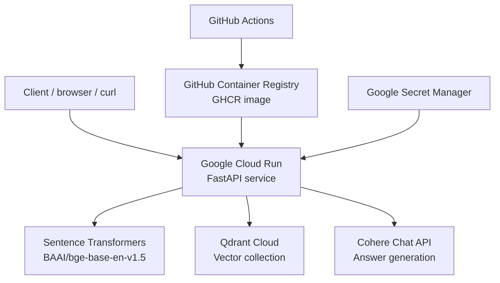

# FiQA Production RAG — Google Cloud Run Deployment Record

**Status:** Historical record of the **first** Cloud Run deployment and authenticated validation (2 November 2026).  
**Current operations (public demo, release process, manual redeploy):** [`public_demo_operations_runbook.md`](public_demo_operations_runbook.md).  
**Last updated:** 2 November 2026 (initial deploy); see public demo runbook for live URL and IAM.  
**Repository:** [`ankush1aggarwal/RAG`](https://github.com/ankush1aggarwal/RAG)

This document records the application changes required for Cloud Run, the Google Cloud infrastructure and IAM setup, the **initial** deployment command, and hosted endpoint validation **using Google identity tokens** (before public `allUsers` invoke was enabled).

> **Validation result (initial, private invoke):** Cloud Run created the service and routed 100% of traffic to the deployed revision. Authenticated calls to `/health`, `/ready`, and `/query` returned HTTP 200. The service was later opened for public invocation; ongoing ops are documented in [`public_demo_operations_runbook.md`](public_demo_operations_runbook.md).

---

## 1. Deployment architecture

The deployed API uses the following architecture:



The intended runtime profile remains the previously evaluated frozen dense-retrieval profile:

| Setting | Value |
|---|---|
| Corpus | BEIR FiQA-2018 |
| Collection | `fiqa_cs200_bge_base_en_v1_5` |
| Documents in committed ingest manifest | 57,638 |
| Chunks / expected vector points | 72,851 |
| Embedding model | `BAAI/bge-base-en-v1.5` |
| Embedding dimension | 768 |
| Chunk size | 200 words |
| Chunk overlap | 20% |
| Retrieval | Dense |
| Retrieval depth | `top_k=10` |
| Reranking | Disabled |
| LLM provider | Cohere |
| API | FastAPI |
| Vector database | Qdrant Cloud |
| Hosting | Google Cloud Run |

The local development path is preserved: when `QDRANT_URL` is not configured, the application can continue to use local Qdrant through `QDRANT_PATH`.

---

## 2. Application and container changes for cloud deployment

The application was prepared for a hosted runtime before deploying it.

### 2.1 Local and remote Qdrant connection support

The application now supports both local and remote Qdrant connections:

- If `QDRANT_URL` is set, the application connects to Qdrant Cloud using `QDRANT_URL` and `QDRANT_API_KEY`.
- Otherwise, it retains the local persistent or in-memory Qdrant behaviour through `QDRANT_PATH`.
- The connection factory is implemented in `src/app/retrieval/qdrant_connection.py`.

Cloud Run environment variables:

```text
QDRANT_URL=https://<your-cluster-host>:6333
QDRANT_API_KEY=<Secret Manager value>
```

`QDRANT_PATH` is not used when `QDRANT_URL` is set.

### 2.2 Cloud Run port support

Cloud Run supplies the listening port through the `PORT` environment variable. The API startup script reads `PORT` and uses `8000` as the local-development fallback. The Docker image defaults to port `8080` and starts Uvicorn on `0.0.0.0`.

Relevant files:

- `src/scripts/serve_api.py`
- `Dockerfile`

### 2.3 Ingestion manifest packaged in the image

The frozen dense retrieval readiness check needs the ingestion manifest to compare the deployed Qdrant collection with the expected ingest configuration. Since the production profile does not use BM25, the BM25 `.pkl` file is not required for the frozen dense `/ready` check.

The manifest is packaged at:

```text
deploy/index_metadata/fiqa_cs200_bge_base_en_v1_5.manifest.json
```

The container defaults to:

```text
BM25_INDEX_DIR=deploy/index_metadata
```

The committed manifest records 57,638 documents, 72,851 chunks, the 768-dimensional BGE embedding, and the frozen collection configuration. After any future re-ingestion, copy the newly generated manifest into `deploy/index_metadata/`, commit it, rebuild the image, and redeploy.

### 2.4 BGE model cached in the Docker image

The Docker build runs `src/scripts/prefetch_embedding_model.py` and stores the BGE model under `/app/.cache/huggingface`. This avoids depending on a Hugging Face model download during each Cloud Run cold start.

### 2.5 Cohere dependency included in the runtime image

The Dockerfile installs all runtime extras required by the hosted configuration:

```dockerfile
RUN pip install ".[api,embeddings,hosted]"
```

The `hosted` extra provides the Cohere client. The production service uses `LLM_PROVIDER=cohere`; it does not run Ollama inside the Cloud Run container.

### 2.6 GitHub Actions image publishing

The existing `.github/workflows/container.yml` workflow builds and smoke-tests the Docker image, then publishes it to GitHub Container Registry (GHCR) on pushes to `main` and version tags. It publishes the `latest` tag and a commit-SHA tag.

The image used for the **first** successful deployment was:

```text
ghcr.io/ankush1aggarwal/fiqa-production-rag:148ead4
```

**Current production demo** (manual release on `main`): **`4f5ddf3`** — see [`public_demo_operations_runbook.md`](public_demo_operations_runbook.md).

---

## 3. Google Cloud project and region

The Cloud Run project configuration used was:

| Item | Value |
|---|---|
| Google Cloud project ID | `fiqa-production-rag` |
| Cloud Run service | `fiqa-rag-api` |
| Region | `asia-south1` (Mumbai) |
| Container port | `8080` |
| Runtime service account | `fiqa-rag-cloud-run@fiqa-production-rag.iam.gserviceaccount.com` |

The deployment used GHCR directly, so Artifact Registry was not required for this first deployment.

### 3.1 Select the project and enable APIs

Run in Google Cloud Shell:

```bash
gcloud config set project fiqa-production-rag

gcloud services enable \
  run.googleapis.com \
  secretmanager.googleapis.com
```

The active Google Cloud CLI account used during deployment was:

```text
ankush.aggarwal@iitbombay.org
```

Check the active CLI identity and project with:

```bash
gcloud auth list
gcloud config get-value project
gcloud config get-value account
```

---

## 4. Runtime service account and IAM setup

A dedicated user-managed service account is used by the Cloud Run service:

```text
fiqa-rag-cloud-run@fiqa-production-rag.iam.gserviceaccount.com
```

### 4.1 Service-account naming issue encountered

During troubleshooting, the project service-account listing showed this account:

```text
EMAIL:         729436472430-compute@developer.gserviceaccount.com
DISPLAY NAME:  fiqa-rag-cloud-run
```

This was the default Compute Engine service account. Its display name did **not** make its email address equivalent to the intended user-managed service account. The deployment command must use the full email address of the actual user-managed service account:

```text
fiqa-rag-cloud-run@fiqa-production-rag.iam.gserviceaccount.com
```

To list service accounts and verify the actual email addresses:

```bash
gcloud iam service-accounts list \
  --project=fiqa-production-rag \
  --format="table(email,displayName,disabled)"
```

### 4.2 Create the dedicated service account

If it does not already exist, create it (this is a one-time operation):

```bash
gcloud iam service-accounts create fiqa-rag-cloud-run \
  --project=fiqa-production-rag \
  --display-name="FiQA RAG Cloud Run runtime"
```

The resulting email should be:

```text
fiqa-rag-cloud-run@fiqa-production-rag.iam.gserviceaccount.com
```

### 4.3 Allow the deploying user to attach the runtime service account

The initial Cloud Run deployment failed with:

```text
Permission 'iam.serviceaccounts.actAs' denied
```

The deploying user needs the **Service Account User** role on the runtime service account. This role permits the user to attach that service account to the Cloud Run service.

```bash
gcloud iam service-accounts add-iam-policy-binding \
  fiqa-rag-cloud-run@fiqa-production-rag.iam.gserviceaccount.com \
  --member="user:ankush.aggarwal@iitbombay.org" \
  --role="roles/iam.serviceAccountUser" \
  --project=fiqa-production-rag
```

If this command returns a permission error, a project administrator or service-account administrator must grant the binding. Adding a principal in the Console is not enough unless the exact `Service Account User` role is assigned on the correct service account.

To inspect the service account's policy:

```bash
gcloud iam service-accounts get-iam-policy \
  fiqa-rag-cloud-run@fiqa-production-rag.iam.gserviceaccount.com \
  --project=fiqa-production-rag
```

### 4.4 Allow the runtime service account to read the application secrets

The runtime service account, rather than the deploying user, needs permission to access the secret values at runtime. Grant Secret Manager Secret Accessor on each secret:

```bash
gcloud secrets add-iam-policy-binding cohere-api-key \
  --member="serviceAccount:fiqa-rag-cloud-run@fiqa-production-rag.iam.gserviceaccount.com" \
  --role="roles/secretmanager.secretAccessor" \
  --project=fiqa-production-rag
```

```bash
gcloud secrets add-iam-policy-binding qdrant-api-key \
  --member="serviceAccount:fiqa-rag-cloud-run@fiqa-production-rag.iam.gserviceaccount.com" \
  --role="roles/secretmanager.secretAccessor" \
  --project=fiqa-production-rag
```

The two Secret Manager secrets referenced by the deployment are:

| Secret name | Purpose |
|---|---|
| `cohere-api-key` | Cohere chat API authentication |
| `qdrant-api-key` | Qdrant Cloud API authentication |

**Never put secret values in this document, source control, command history, or ordinary environment-variable values.** The deployment command maps Secret Manager versions to container environment variables.

---

## 5. Successful Cloud Run deployment

> **Historical note:** The table and command below describe the **first** deployment with `--no-allow-unauthenticated`. The service is now **publicly invokable**; see [`public_demo_operations_runbook.md`](public_demo_operations_runbook.md).

### 5.1 Runtime configuration

The successful first deployment used:

| Setting | Value |
|---|---|
| Service | `fiqa-rag-api` |
| Image | `ghcr.io/ankush1aggarwal/fiqa-production-rag:148ead4` (first deploy; **current:** `4f5ddf3`) |
| Region | `asia-south1` |
| Port | `8080` |
| CPU | `2` |
| Memory | `4Gi` |
| Concurrency | `1` |
| Minimum instances | `0` |
| Maximum instances | `1` |
| Request timeout | `300` seconds |
| Authentication | Required (private service) |
| Runtime identity | Dedicated `fiqa-rag-cloud-run` service account |
| LLM provider | Cohere |
| Vector database | Qdrant Cloud |

### 5.2 Final deployment command

Run the following from Google Cloud Shell. Replace `<your-cluster-host>` with the actual Qdrant Cloud cluster hostname; do not include angle brackets in the actual command. The Qdrant URL should use the endpoint shown in the Qdrant Cloud console.

```bash
gcloud run deploy fiqa-rag-api \
  --project=fiqa-production-rag \
  --image=ghcr.io/ankush1aggarwal/fiqa-production-rag:4f5ddf3 \
  --region=asia-south1 \
  --port=8080 \
  --cpu=2 \
  --memory=4Gi \
  --concurrency=1 \
  --min=0 \
  --max=1 \
  --timeout=300 \
  --service-account=fiqa-rag-cloud-run@fiqa-production-rag.iam.gserviceaccount.com \
  --set-env-vars="LLM_PROVIDER=cohere,QDRANT_URL=https://<your-cluster-host>:6333,COLLECTION_NAME=fiqa_cs200_bge_base_en_v1_5,API_ENFORCE_FROZEN_RETRIEVAL=true,BM25_INDEX_DIR=deploy/index_metadata" \
  --set-secrets="COHERE_API_KEY=cohere-api-key:latest,QDRANT_API_KEY=qdrant-api-key:latest" \
  --no-allow-unauthenticated
```

The actual deployed image tag and service details observed from the successful deployment are recorded below. The Qdrant URL is deliberately not reproduced here so that no infrastructure endpoint needs to be exposed in this deployment log.

### 5.3 Successful deployment output

Cloud Run reported:

```text
Service [fiqa-rag-api] revision [fiqa-rag-api-00002-v78] has been deployed and is serving 100 percent of traffic.
Service URL: https://fiqa-rag-api-729436472430.asia-south1.run.app
```

The deployed service URL is:

<https://fiqa-rag-api-729436472430.asia-south1.run.app>

Because deployment used `--no-allow-unauthenticated`, the service is private. Requests must include a Google identity token from an authenticated principal with permission to invoke the Cloud Run service.

---

## 6. Operational commands

### 6.1 Get the deployed service URL

```bash
SERVICE_URL=$(gcloud run services describe fiqa-rag-api \
  --region=asia-south1 \
  --project=fiqa-production-rag \
  --format='value(status.url)')

echo "$SERVICE_URL"
```

### 6.2 Get an identity token for private endpoint calls

```bash
TOKEN=$(gcloud auth print-identity-token)
```

### 6.3 Inspect the active service configuration and revision

```bash
gcloud run services describe fiqa-rag-api \
  --region=asia-south1 \
  --project=fiqa-production-rag
```

### 6.4 Read Cloud Run logs

```bash
gcloud run services logs read fiqa-rag-api \
  --region=asia-south1 \
  --project=fiqa-production-rag \
  --limit=50
```

### 6.5 Open a local authenticated proxy (alternative to manually adding identity tokens)

```bash
gcloud run services proxy fiqa-rag-api \
  --region=asia-south1 \
  --project=fiqa-production-rag
```

The proxy listens locally (by default on port `8080`). In a second Cloud Shell terminal, local requests can then be sent to `http://localhost:8080`.

---

## 7. Hosted validation — passed (2 November 2026)

All three hosted endpoint checks completed successfully against the private Cloud Run service. Requests were made with a Google identity token.

### 7.1 Liveness check — passed

Request:

```bash
curl -i \
  -H "Authorization: Bearer $TOKEN" \
  "$SERVICE_URL/health"
```

Observed result:

```text
HTTP/2 200
content-type: application/json
x-request-id: b7c88722-dd1e-4604-83b4-563fdadac819
date: Mon, 02 Nov 2026 16:49:26 GMT
server: Google Frontend
content-length: 15
```

The endpoint returned HTTP 200, confirming that the API process was responding.

### 7.2 Readiness check — passed

Request:

```bash
curl -i \
  -H "Authorization: Bearer $TOKEN" \
  "$SERVICE_URL/ready"
```

Observed result:

```text
HTTP/2 200
content-type: application/json
x-request-id: 04b3c785-730d-4516-80a1-436e23681547
date: Mon, 02 Nov 2026 16:50:00 GMT
server: Google Frontend
content-length: 134

{"status":"ready","qdrant_collection":true,"bm25_index":false,"retrieval_index_aligned":true,"llm_provider":"cohere","llm_ready":true}
```

Interpretation:

| Field | Observed | Meaning |
|---|---:|---|
| `status` | `ready` | The API readiness gate passed. |
| `qdrant_collection` | `true` | The configured Qdrant collection is accessible. |
| `bm25_index` | `false` | Expected for the deployed frozen dense-only profile; BM25 is not required by this profile. |
| `retrieval_index_aligned` | `true` | Qdrant collection and the packaged ingest manifest match the runtime retrieval configuration. |
| `llm_provider` | `cohere` | Cohere is selected as the generation provider. |
| `llm_ready` | `true` | Cohere API key is configured. This check verifies configuration, not a live generation call. |

### 7.3 End-to-end RAG query — passed

Request:

```bash
curl -i -X POST "$SERVICE_URL/query" \
  -H "Authorization: Bearer $TOKEN" \
  -H "Content-Type: application/json" \
  -H "X-Request-ID: cloud-test-001" \
  -d '{"question":"What is APR on a credit card?"}'
```

Observed result:

```text
HTTP/2 200
content-type: application/json
x-request-id: cloud-test-001
date: Mon, 02 Nov 2026 16:50:57 GMT
server: Google Frontend
content-length: 1819
```

The API returned a generated answer, ten citations and the expected dense retrieval metadata. The answer began:

> APR, or Annual Percentage Rate, is the interest rate charged on a credit card when you carry a balance. It represents the cost of borrowing money from the credit card issuer.

Returned citation identifiers (document ID / chunk ID):

| # | Document ID | Chunk ID |
|---:|---:|---:|
| 1 | `551424` | `0` |
| 2 | `521418` | `0` |
| 3 | `263949` | `0` |
| 4 | `48454` | `0` |
| 5 | `263225` | `0` |
| 6 | `59540` | `0` |
| 7 | `65532` | `1` |
| 8 | `279845` | `0` |
| 9 | `318520` | `1` |
| 10 | `170167` | `0` |

The response retrieval metadata was:

```json
{
  "method": "dense",
  "top_k": 10,
  "reranker": null,
  "candidates_retrieved": null
}
```

This confirms the hosted request completed the full application path: query embedding with the packaged BGE model, dense retrieval from Qdrant Cloud, Cohere answer generation, and citation response assembly.

### 7.4 Validation summary

| Check | HTTP status | Result |
|---|---:|---|
| `GET /health` | `200` | Passed |
| `GET /ready` | `200` | Passed |
| `POST /query` | `200` | Passed; answer and 10 citations returned |

The service is validated for this basic end-to-end test. This does not yet constitute load, concurrency, resilience, citation-grounding or public-abuse testing. Continue to keep the service private until request protection and the public demo plan are ready.

---

## 8. Security and cost guardrails

> **Superseded in part:** Public invocation, application request limits, and the **manual post-merge release** are documented in [`public_demo_operations_runbook.md`](public_demo_operations_runbook.md). The bullets below reflect the **initial** private-deploy posture.

- Keep the service private until request protection is implemented; endpoint validation has passed, but public-abuse controls are not yet in place.
- Keep `--max=1` while evaluating the service and its cost profile.
- Keep Cohere and Qdrant API keys in Secret Manager; do not commit credentials.
- Use the dedicated runtime service account rather than a broad default service account.
- Set a Google Cloud billing budget alert. A budget alert is a notification, not a hard spending cap.
- Monitor Cohere and Qdrant usage separately; their charges are independent of Cloud Run compute charges.
- Before enabling public invocation, add request rate limiting or another suitable abuse-control mechanism because public requests can consume Cohere API quota and incur costs.

---

## 9. Current deployment status

| Item | Status |
|---|---|
| Cloud-compatible Qdrant connection code | Implemented |
| Cloud Run `PORT` support | Implemented |
| Ingest manifest packaged in image | Implemented |
| BGE model prefetch in Docker build | Implemented |
| Cohere runtime dependency included | Implemented |
| Docker image published to GHCR | Available; **current Cloud Run tag** `4f5ddf3` (first deploy `148ead4`) |
| Google Cloud project | `fiqa-production-rag` |
| Dedicated Cloud Run runtime service account | Used by successful deployment |
| Secret Manager integration | Runtime secrets successfully used by the Qdrant and Cohere-backed query path |
| Cloud Run service creation | Successful |
| Revision `fiqa-rag-api-00002-v78` | Serving 100% of traffic |
| `/health` hosted test | Passed — HTTP 200 (2 November 2026) |
| `/ready` hosted test | Passed — HTTP 200; Qdrant and retrieval aligned; Cohere configured |
| End-to-end `/query` hosted test | Passed — HTTP 200; answer and 10 citations returned |
| Public demo + request protection | See [`public_demo_operations_runbook.md`](public_demo_operations_runbook.md) |
| Automated Cloud Run deploy on `main` | **Parked** — manual release only ([`public_demo_operations_runbook.md`](public_demo_operations_runbook.md)) |
| Load / concurrency / resilience testing | Initial baseline in public demo runbook §5; not a formal benchmark |
| Public demo | Public API + OpenAPI (`/docs`); no separate UI — README screenshots |

**Next action:** After each merge to `main`, follow the **manual release** in [`public_demo_operations_runbook.md` §7](public_demo_operations_runbook.md#7-manual-release-procedure-after-a-merge-to-main) once CI and Container workflows succeed.

---

## 10. Related project documentation

| Document | Role |
|----------|------|
| [`public_demo_operations_runbook.md`](public_demo_operations_runbook.md) | **Current ops:** public URL, request limits, CI vs manual Cloud Run release, rollback. |
| [`cloud_run.md`](cloud_run.md) | App-side Cloud Run prep: Qdrant local vs cloud, migration/re-ingest, env vars, manifest + BGE bake. |
| **This file** | First-deploy history: GCP project, IAM, Secret Manager, authenticated validation log. |
| [`docker.md`](docker.md) | Docker build, GHCR workflow (automation stops at image push). |
| [`api_contract.md`](api_contract.md) | HTTP endpoints, request/response models, `/ready` fields. |
| [`architecture.md`](architecture.md) | Dev → CI → GHCR → Cloud Run topology. |
| [`deploy/index_metadata/README.md`](../deploy/index_metadata/README.md) | Manifest packaging and refresh after re-ingest. |
| [`RAG_PROJECT_ROADMAP.md`](RAG_PROJECT_ROADMAP.md) | Week 9 progress. |
